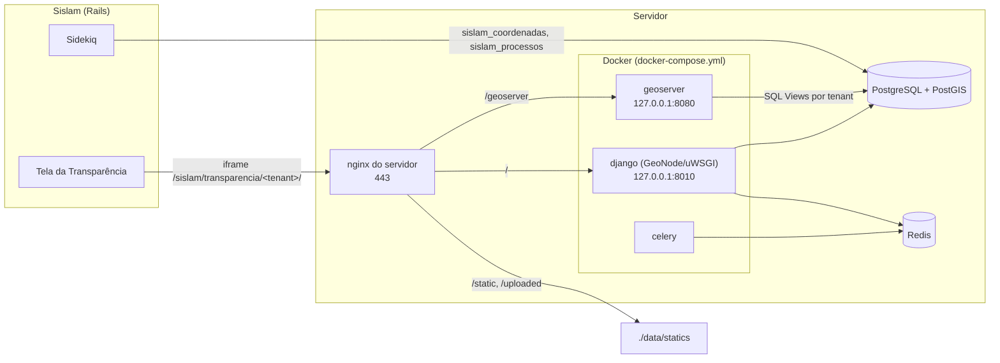

# Sislam GIS (GeoNode): implementação, instalação e operação

Guia técnico do fork `SislamGisGeonode` (geonode-project 5.1.0) e da integração com o Sislam (`sislam2_0`).
Visão de negócio, resultados e riscos: [SISLAM_SPIKE.md](SISLAM_SPIKE.md).

## Sumário

1. [Arquitetura](#1-arquitetura)
2. [O que é customização do Sislam](#2-o-que-é-customização-do-sislam)
3. [Modelo de dados e isolamento por tenant](#3-modelo-de-dados-e-isolamento-por-tenant)
4. [Ambiente local](#4-ambiente-local)
5. [Instalação no servidor](#5-instalação-no-servidor)
6. [Integração com o Sislam (Rails)](#6-integração-com-o-sislam-rails)
7. [Operação](#7-operação)
8. [Solução de problemas](#8-solução-de-problemas)
9. [Checklist de homologação](#9-checklist-de-homologação)

---

## 1. Arquitetura



| Componente | Versão | Onde roda | Observação |
|---|---|---|---|
| GeoNode (Django 5.2, Python 3.12) | 5.1.0 | container `django4<projeto>` | Porta só em `127.0.0.1:8010` |
| Celery (worker + beat) | — | container `celery4<projeto>` | Tarefas assíncronas do GeoNode |
| GeoServer (build GeoNode, GeoFence, OAuth2) | 2.28.4 | container `geoserver4<projeto>` | Porta só em `127.0.0.1:8080`; *data dir* no volume `<projeto>-gsdatadir` |
| PostgreSQL + PostGIS | 15+ / 3.x | **servidor** | Bancos `sislam_gis` (GeoNode) e `sislam_gis_data` (dados geográficos) |
| Redis | 7 | **servidor** | Usuário ACL `geonode`, bancos 12 (broker) e 13 (resultados) |
| nginx | — | **servidor** | Vhost gerado de `deploy/nginx/sislam-gis.conf.template` |

Os containers alcançam o PostgreSQL e o Redis do servidor por `host.docker.internal` (mapeado para
`host-gateway`, o IP `172.17.0.1` da interface `docker0`).

**Fluxo de dados**

1. O Sislam grava cada `Coordenada` (e os atributos do seu `Processo`) em `sislam_gis_data`: em tempo real
   pelo Sidekiq e numa carga completa diária.
2. O GeoServer publica, por tenant, SQL Views sobre essas tabelas.
3. A tela da Transparência do Sislam embute `/sislam/transparencia/<tenant>/` em iframe, passando os filtros
   do formulário pela URL. A página valida os filtros, monta o `CQL_FILTER` e desenha a camada WMS.

**Repositórios**

| Repositório | Branch | Conteúdo |
|---|---|---|
| `SislamGisGeonode` (fork do geonode-project) | `sislam-main` | GeoNode customizado, SQL, nginx, compose |
| `sislam2_0` | `feature/sislam-gis-geonode` | Sincronização, rake, tela da Transparência |

---

## 2. O que é customização do Sislam

Tudo fica no projeto, sem alterar o núcleo do GeoNode.

| Caminho (fork) | Função |
|---|---|
| `src/geonode_project/sislam_sso/` | SSO: `/sso/sislam-login/?token=<jwt>&next=<url>` troca um JWT RS256 do Sislam por sessão no GeoNode e coloca o usuário no grupo do tenant. Chave pública em `keys/sislam_pub.pem`. `middleware.py` grava os cookies de sessão/CSRF como particionados (CHIPS) para o login funcionar dentro de iframe de outro domínio |
| `src/geonode_project/sislam_tenant/management/commands/sislam_provision_tenant.py` | Provisiona um tenant: SQL Views no GeoServer, datasets no GeoNode, grupo, permissões e mapa padrão |
| `src/geonode_project/sislam_tenant/views.py` + `templates/` | Página pública do mapa da Transparência (`/sislam/transparencia/<tenant>/`) |
| `src/geonode_project/settings.py` | Registra os apps `sislam_sso` e `sislam_tenant` e o middleware de cookies |
| `sql/001_sislam_coordenadas.sql`, `sql/002_sislam_processos.sql` | Tabelas da base geográfica |
| `deploy/nginx/sislam-gis.conf.template` | Vhost do nginx (produção e desenvolvimento) |
| `deploy/nginx/dev/sislam-rails.conf.template` | Só desenvolvimento: `<tenant>.sislam.localhost` → Rails local |
| `docker-compose.yml` | Serviços do GeoNode sem banco, Redis e nginx próprios; portas só em loopback |
| `docker-compose.dev.yml` | Só desenvolvimento: nginx local e código montado de `./src` |
| `.env.sample`, `create-envfile.py` | Variáveis `SISLAM_GIS_*`, `SISLAM_SSO_*` e senha do Redis |

---

## 3. Modelo de dados e isolamento por tenant

Banco `sislam_gis_data` (dono: `sislam_gis_data`).

**`sislam_coordenadas`**: uma linha por `Coordenada` de cada tenant, **inclusive as inválidas**.

| Coluna | Origem no Sislam |
|---|---|
| `tenant_id`, `coordenada_id` | nome do banco do tenant, `coordenadas.id` (chave única) |
| `coordenable_type`, `coordenable_id` | coordenável polimórfico |
| `processo_id` | processo do coordenável (Processo, ProcessoInfoAdicional ou SolicitaFiscalizacao); nulo nos demais |
| `latitude`, `longitude`, `srid` | texto `latitude`/`longitude` convertido; SRID pelo `datum` (SIRGAS2000 4674, WGS84 4326, SAD69 4618, Córrego Alegre 4225) |
| `tipo`, `datum`, `nao_aplica`, `grupo`, `ponto`, `descricao` | campos da coordenada; `descricao` é o texto do popup |
| `geom` | calculada pelo banco: ponto em SIRGAS 2000 **só se estiver dentro do Brasil**; nula caso contrário (fica gravado, não aparece no mapa) |

**`sislam_processos`**: uma linha por processo com coordenada, com os campos dos filtros da Transparência
(`tp_solicitacao_id`, `status`, `processo_created_at`, `bairro`, `endereco`, `atividade_ids`,
`tp_documento_ids`, `atividade_servico_id`, `visivel_transparencia`). Listas no formato `,3,7,` para o filtro
CQL `LIKE '%,3,%'`.

**Camadas por tenant** (criadas pelo `sislam_provision_tenant`):

| Camada | Conteúdo | Acesso |
|---|---|---|
| `geonode:sislam_<tenant>` | todas as coordenadas do tenant com os atributos do processo | só o grupo do tenant |
| `geonode:sislam_<tenant>_transparencia` (com `--transparencia`) | só o que a Transparência mostra: com geometria, ligado a processo e visível pela regra do `CoordenadaVisibilidadeService` | anônimo: visualização (WMS e popup); download (WFS) só o grupo |

O isolamento vem de quatro camadas: `tenant_id` em toda linha e chave única; join sempre por
`(tenant_id, processo_id)`; cada SQL View fixa `WHERE tenant_id = '<tenant>'` (o `CQL_FILTER` da requisição
só soma condições); permissões do GeoNode/GeoFence por grupo.

---

## 4. Ambiente local

Objetivo: rodar GeoNode em `https://gis.sislam.localhost` e o Sislam em `https://<tenant>.sislam.localhost` e
`https://<tenant>.msmeioambiente.localhost`, reproduzindo os dois domínios da produção. Nomes `*.localhost`
resolvem para o próprio computador, sem mexer em `/etc/hosts`.

### 4.1 Pré-requisitos

- Docker Engine 24+ com o plugin `docker compose`.
- PostgreSQL 15+ com PostGIS 3 instalado no computador (o mesmo usado pelo Sislam).
- Redis 7 instalado no computador.
- [mkcert](https://github.com/FiloSottile/mkcert) para certificados locais confiáveis.
- Sislam rodando localmente (`rails s` em `localhost:3000`, ver o `CLAUDE.md` do `sislam2_0`).
- ~8 GB de RAM livres para os containers.

### 4.2 PostgreSQL

```sql
-- como postgres
CREATE ROLE sislam_gis LOGIN PASSWORD '<senha-geonode>';
CREATE DATABASE sislam_gis OWNER sislam_gis;
CREATE ROLE sislam_gis_data LOGIN PASSWORD '<senha-geodados>';
CREATE DATABASE sislam_gis_data OWNER sislam_gis_data;
\c sislam_gis
CREATE EXTENSION postgis;
\c sislam_gis_data
CREATE EXTENSION postgis;
```

Liberar o acesso dos containers. Em `postgresql.conf`:

```
listen_addresses = 'localhost,172.17.0.1'
```

Em `pg_hba.conf`, a rede do compose (descobrir com
`docker network inspect geonode_project_default --format '{{range .IPAM.Config}}{{.Subnet}}{{end}}'` depois
do primeiro `docker compose up`; costuma ser `172.18–172.30.0.0/16`):

```
host  sislam_gis,sislam_gis_data  sislam_gis,sislam_gis_data  172.21.0.0/16  scram-sha-256
```

Fazer o PostgreSQL subir depois do Docker (senão, no boot, `172.17.0.1` ainda não existe e é ignorado sem erro):

```bash
sudo systemctl edit postgresql   # acrescentar as duas linhas abaixo e salvar
# [Unit]
# After=docker.service
sudo systemctl restart postgresql
```

### 4.3 Redis

```bash
redis-cli ACL SETUSER geonode on '><senha-redis>' '~*' '&*' +@all -@admin -flushall -flushdb
redis-cli CONFIG REWRITE
```

Em `/etc/redis/redis.conf` (só desenvolvimento; produção na seção 5.4):

```
bind 127.0.0.1 -::1 -172.17.0.1
protected-mode no
```

O Redis 7 recusa conexões que não vêm do loopback enquanto o usuário `default` não tem senha, mesmo com
`bind` e usuário ACL; localmente basta `protected-mode no`. Também subir depois do Docker:

```bash
sudo systemctl edit redis-server   # [Unit] / After=docker.service
sudo systemctl restart redis-server
ss -ltn | grep 6379                # precisa aparecer 172.17.0.1:6379
```

### 4.4 Certificados

```bash
mkcert -install    # uma vez por computador
mkcert -cert-file fullchain.pem -key-file privkey.pem \
  gis.sislam.localhost '*.sislam.localhost' '*.msmeioambiente.localhost'
sudo mkdir -p data/certs && sudo mv fullchain.pem privkey.pem data/certs/ && sudo chmod 600 data/certs/privkey.pem
```

(`data/` passa a pertencer ao root depois da primeira subida dos containers, por isso o `sudo`.)

### 4.5 Arquivo `.env`

```bash
python3 create-envfile.py --hostname gis.sislam.localhost --https --email <seu-email> --env_type dev \
  --geonodepwd '<admin-geonode>' --geoserverpwd '<admin-geoserver>' \
  --dbpwd '<senha-geonode>' --geodbpwd '<senha-geodados>' --redispwd '<senha-redis>'
```

> O `create-envfile.py` **sobrescreve** o `.env`. Depois de ajustado, não rode de novo.

Ajustar à mão no `.env` gerado (o `.env.sample` ainda traz os valores do modelo com banco em container):

```
GEONODE_DATABASE=sislam_gis
GEONODE_DATABASE_USER=sislam_gis
GEONODE_GEODATABASE=sislam_gis_data
GEONODE_GEODATABASE_USER=sislam_gis_data
DATABASE_HOST=host.docker.internal
DATABASE_URL=postgis://sislam_gis:<senha-geonode>@host.docker.internal:5432/sislam_gis
GEODATABASE_URL=postgis://sislam_gis_data:<senha-geodados>@host.docker.internal:5432/sislam_gis_data
BROKER_URL=redis://geonode:<senha-redis>@host.docker.internal:6379/12
CELERY_RESULT_BACKEND=redis://geonode:<senha-redis>@host.docker.internal:6379/13
ALLOWED_HOSTS="['django', 'localhost', 'gis.sislam.localhost']"

SISLAM_GIS_HOST=gis.sislam.localhost
SISLAM_GIS_FRAME_ANCESTORS="https://*.sislam.localhost https://*.msmeioambiente.localhost"
SISLAM_GIS_CERT_DIR=/etc/ssl/sislam-gis
COMPOSE_FILE=docker-compose.yml:docker-compose.dev.yml
```

`COMPOSE_FILE` faz o `docker compose` carregar também o `docker-compose.dev.yml`: um nginx local com o mesmo
vhost da produção (e o vhost `<tenant>.sislam.localhost` → Rails em `localhost:3000`) e o código de `./src`
montado nos containers.

### 4.6 Subir

```bash
docker compose build
docker compose up -d
docker compose ps            # aguardar django e geoserver "healthy" (a 1ª subida leva alguns minutos)
docker compose logs -f django
```

Na primeira subida o GeoNode cria as tabelas, o usuário `admin` (senha do `ADMIN_PASSWORD`), o app OAuth do
GeoServer e o `Site` com o domínio do `.env`, e grava `data/statics/geonode_init.lock`. Esses valores **não
são refeitos** nas subidas seguintes (ver [7.2](#72-trocar-o-domínio)).

Acessos: `https://gis.sislam.localhost` (GeoNode) e `https://gis.sislam.localhost/geoserver/web` (GeoServer).

### 4.7 Base geográfica

Rodar **conectado como `sislam_gis_data`** (dono das tabelas; criadas como `postgres`, ficam inacessíveis):

```bash
psql -h localhost -U sislam_gis_data -d sislam_gis_data -f sql/001_sislam_coordenadas.sql
psql -h localhost -U sislam_gis_data -d sislam_gis_data -f sql/002_sislam_processos.sql
```

### 4.8 Provisionar um tenant e carregar os dados

```bash
docker compose exec django python manage.py sislam_provision_tenant crs --title "CRS" --transparencia
```

No `sislam2_0`:

```bash
GEONODE_GEODATABASE_PASSWORD='<senha-geodados>' DB_DEV=crs RAILS_ENV=development \
  ~/.rvm/wrappers/ruby-2.7.6@sislam5/bundle exec rake geonode:backfill
# Backfill concluído para crs: 2021 coordenadas processadas, 0 com erro.
# No GeoNode: 2021 coordenadas, 267 sem geometria (fora do Brasil), 871 no mapa da Transparência.
```

### 4.9 Sislam local apontando para o GeoNode

```bash
GEONODE_BASE_URL=https://gis.sislam.localhost GEONODE_TRANSPARENCIA_TENANTS=crs \
GEONODE_GEODATABASE_PASSWORD='<senha-geodados>' DB_DEV=crs ~/.rvm/wrappers/ruby-2.7.6@sislam5/rails s
```

Abrir `https://crs.sislam.localhost/transparencia/mapas` e `https://crs.msmeioambiente.localhost/transparencia/mapas`.
O formulário abre com os últimos 30 dias (padrão do Sislam); sem processos nesse período o mapa fica vazio.

Para os specs do Sislam, o banco geográfico de teste é `project_data_test` (usuário `project_data`, ver
`config/geonode_database.yml`): precisa de PostGIS, das duas tabelas criadas como `project_data` e de
`GRANT CREATE ON SCHEMA public TO project_data` quando o banco não pertence a esse usuário.

### 4.10 Dia a dia

- Mudou código Python ou template do fork: `docker compose restart django` (o uWSGI não recarrega sozinho;
  reinicie também o `celery` se mexer em tarefas).
- Mudou o template do nginx ou `SISLAM_GIS_*`: `docker compose restart nginx`.
- Logs: `docker compose logs -f django geoserver celery nginx`.

---

## 5. Instalação no servidor

### 5.1 Requisitos

| Recurso | Recomendação |
|---|---|
| RAM livre | 6 a 8 GB (medido parado: django 0,7 GB, celery 1,2 GB, GeoServer 1,6 GB; `GEOSERVER_JAVA_OPTS` usa `-Xms4G -Xmx4G`, ajustável) |
| Disco | 20 GB (imagens ~5,4 GB + volumes, logs e uploads) |
| Software | Docker Engine 24+ e plugin compose; PostgreSQL 15+ com PostGIS 3; Redis 7; nginx |
| DNS e certificado | domínio do GIS (ex.: `gis.sislam.com.br`) e certificado válido para ele |

### 5.2 Código

O vhost do nginx aponta os estáticos para `/opt/SislamGisGeonode/data/statics`, então o repositório fica
nesse caminho:

```bash
sudo git clone <url-do-fork> /opt/SislamGisGeonode
cd /opt/SislamGisGeonode && sudo git checkout sislam-main
```

### 5.3 PostgreSQL

Mesmos comandos da [4.2](#42-postgresql), com senhas fortes e `scram-sha-256` (nunca `trust`). Pontos de atenção:

- `listen_addresses` inclui `172.17.0.1`, e o `After=docker.service` é obrigatório.
- `pg_hba.conf`: liberar só os dois bancos e os dois usuários para a sub-rede do compose. Para não depender
  da sub-rede sorteada pelo Docker, crie a rede antes (`docker compose up --no-start`), confira com
  `docker network inspect` e só então ajuste o `pg_hba.conf`.
- O Sislam (Sidekiq) também grava em `sislam_gis_data`; se roda em outro servidor, liberar esse acesso e
  configurar `GEONODE_GEODATABASE_HOST` (em produção o `config/geonode_database.yml` não tem padrão de host).

### 5.4 Redis

```bash
redis-cli ACL SETUSER geonode on '><senha-redis>' '~*' '&*' +@all -@admin -flushall -flushdb
redis-cli CONFIG REWRITE
redis-cli CONFIG GET maxmemory-policy    # deve ser noeviction ou volatile-*: com allkeys-* o Redis pode descartar filas do Celery
redis-cli INFO keyspace                  # confirmar que os bancos 12 e 13 estão livres
```

Em produção **mantenha `protected-mode yes`**. Para ele aceitar conexões dos containers, o usuário `default`
precisa ter senha ou estar desativado. O Sislam em produção já usa usuário ACL próprio (`sislam`, em
`config/redis.yml`), então normalmente dá para desativar o `default`. Antes, confira se nenhum serviço o usa
(`redis-cli CLIENT LIST`, coluna `user`):

```
# redis.conf
bind 127.0.0.1 -::1 -172.17.0.1
protected-mode yes
```

```bash
redis-cli ACL SETUSER default off && redis-cli CONFIG REWRITE   # ou: ACL SETUSER default on '>senha'
sudo systemctl edit redis-server                                 # [Unit] / After=docker.service
sudo systemctl restart redis-server && ss -ltn | grep 6379
```

Não há ACL por número de banco: o usuário `geonode` enxerga os demais bancos. Se isso não for aceitável, use uma
instância Redis separada.

### 5.5 `.env` de produção

Gerar com o `create-envfile.py` (como na [4.5](#45-arquivo-env), com `--env_type prod`; para não deixar senhas
no histórico do shell use `--file <json>`) e aplicar os mesmos ajustes de banco, Redis e `SISLAM_GIS_*`, com:

```
SISLAM_GIS_HOST=gis.sislam.com.br
SISLAM_GIS_FRAME_ANCESTORS="https://*.sislam.com.br https://*.msmeioambiente.com.br"
SISLAM_GIS_CERT_DIR=/etc/ssl/sislam-gis
ALLOWED_HOSTS="['django', 'gis.sislam.com.br']"
DEBUG=False
```

Sem `COMPOSE_FILE` (o `docker-compose.dev.yml` é só para desenvolvimento). Guarde o `.env` com permissão
restrita (`chmod 600`): ele tem todas as senhas.

### 5.6 Build e subida

```bash
cd /opt/SislamGisGeonode
docker compose build
docker compose up -d
docker compose ps
curl -sI http://127.0.0.1:8010/ | head -1              # GeoNode
curl -sI http://127.0.0.1:8080/geoserver/ows | head -1  # GeoServer
```

### 5.7 nginx

```bash
cd /opt/SislamGisGeonode
set -a; . <(grep '^SISLAM_GIS_' .env); set +a
envsubst "$(printf '${%s} ' SISLAM_GIS_HOST SISLAM_GIS_FRAME_ANCESTORS SISLAM_GIS_CERT_DIR)" \
  < deploy/nginx/sislam-gis.conf.template | sudo tee /etc/nginx/sites-available/sislam-gis.conf >/dev/null
sudo ln -s /etc/nginx/sites-available/sislam-gis.conf /etc/nginx/sites-enabled/
sudo nginx -t && sudo systemctl reload nginx
```

O vhost espera `fullchain.pem` e `privkey.pem` em `SISLAM_GIS_CERT_DIR` (certificado da empresa ou certbot no
servidor; o Let's Encrypt em container foi removido). Ele já faz o redirecionamento 80→443, o proxy de `/` e
`/geoserver`, serve `/static` e `/uploaded` direto do disco e envia o `Content-Security-Policy: frame-ancestors`
liberando o iframe só para os domínios do Sislam nos caminhos `/maps/<id>/embed`, `/sso/sislam-login/` e
`/sislam/transparencia/<tenant>/`.

Ao mudar o template ou o `.env`, gere o vhost de novo com os mesmos comandos.

### 5.8 Firewall

- `8010` e `8080` já escutam só em `127.0.0.1`.
- `5432` e `6379` não devem ficar abertos para fora. Com `ufw` ativo e política de entrada `deny`, libere só a
  sub-rede do compose para o `172.17.0.1`:
  `sudo ufw allow from <subnet-compose> to 172.17.0.1 port 5432,6379 proto tcp`.

### 5.9 Base geográfica e tenants

```bash
psql -h localhost -U sislam_gis_data -d sislam_gis_data -f sql/001_sislam_coordenadas.sql
psql -h localhost -U sislam_gis_data -d sislam_gis_data -f sql/002_sislam_processos.sql
docker compose exec django python manage.py sislam_provision_tenant <tenant> --title "<Nome>" --transparencia
```

`--transparencia` só para tenants com o mapa da Transparência habilitado no Sislam
(`ConfigCliente.geral.exibe_mapa_transparencia`).

### 5.10 Sislam (Rails) em produção

Variáveis de ambiente (em **todos** os servidores que rodam o Sidekiq, porque o sync em tempo real dispara
para qualquer tenant):

| Variável | Exemplo | Uso |
|---|---|---|
| `GEONODE_GEODATABASE_HOST` | `localhost` | banco geográfico (obrigatória em produção) |
| `GEONODE_GEODATABASE_PORT` | `5432` | |
| `GEONODE_GEODATABASE_NAME` | `sislam_gis_data` (padrão) | |
| `GEONODE_GEODATABASE_USERNAME` | `sislam_gis_data` (padrão) | |
| `GEONODE_GEODATABASE_PASSWORD` | — | |
| `GEONODE_BASE_URL` | `https://gis.sislam.com.br` | URL do iframe |
| `GEONODE_TRANSPARENCIA_TENANTS` | `crs,pinhais` | tenants que usam o mapa novo; os demais seguem no Google Maps |

Depois do deploy:

1. Atualizar o crontab do `whenever` (o `agendamentos:diarios` passa a enfileirar o `GeonodeBackfillWorker`).
2. Carga inicial de cada tenant habilitado, com a mesma convenção do `rake db:migrate`:
   `DB_DEV=<tenant> bundle exec rake geonode:backfill`.
3. Incluir o tenant em `GEONODE_TRANSPARENCIA_TENANTS` e reiniciar a aplicação.

---

## 6. Integração com o Sislam (Rails)

| Peça | Arquivo (`sislam2_0`) | Comportamento |
|---|---|---|
| Sync da coordenada | `app/workers/sync_coordenada_geonode_worker.rb` | `after_commit` de `Coordenada` (criar, editar, excluir). Envia todas as coordenadas; lat/long saem do texto; grava também a linha do processo |
| Sync do processo | `app/workers/sync_processo_geonode_worker.rb` | `after_commit` de `Processo` quando muda `status` ou `tp_solicitacao_id`, ou na exclusão. Só atualiza processos que já estão no GIS |
| Gatilhos existentes | `TpDenuncia`, `SolicitaDenunciaFiscalizacao`, `SolicitaServico` | Reenviam as coordenadas afetadas quando a visibilidade muda |
| Atributos | `app/services/processo_geo_atributos_service.rb` | Resolve os 8 filtros pelos mesmos caminhos dos `ransack_alias` de `Coordenada` |
| Visibilidade | `app/services/coordenada_visibilidade_service.rb` | Regra da Transparência (denúncia oculta, processo sem denúncia/serviço) |
| Carga completa | `app/workers/geonode_backfill_worker.rb`, `lib/tasks/geonode.rake` | Rake manual (carga inicial) e diária às 03:00 (só tenants já carregados). Reenvia tudo, remove excluídos e processos sem coordenada |
| Acesso à base | `app/models/geo_coordenada.rb`, `app/models/geo_processo.rb`, `config/geonode_database.yml` | Conexão `pg` direta (o multitenant do Sislam não permite uma segunda conexão ActiveRecord) |
| Tela | `app/controllers/transparencia/mapas_controller.rb`, `app/services/transparencia_geonode_url_service.rb`, `app/views/transparencia/mapas/index.slim` | Tenant habilitado: formulário + iframe, sem consultar `coordenadas`; demais: Google Maps |
| SSO | `app/models/sislam_sign/geonode_token.rb` | JWT RS256, validade 60 s. **Pendente:** incluir `iss: "sislam"` e `aud: "sislam-gis"` (exigidos pelo GeoNode; ver `SISLAM_SSO_ISSUER`/`SISLAM_SSO_AUDIENCE`) |

**Parâmetros da página do mapa** (`/sislam/transparencia/<tenant>/`), montados pelo
`TransparenciaGeonodeUrlService` a partir do formulário:

| Parâmetro | Campo do formulário | Filtro aplicado |
|---|---|---|
| `tp_solicitacao` | Tipo solicitação | `tp_solicitacao_id = N` |
| `tp_documento` | Tipo de documento | `tp_documento_ids LIKE '%,N,%'` |
| `de`, `ate` (`AAAA-MM-DD`) | Data de / até | `processo_created_at >= / <=` (meia-noite, como o ransack) |
| `bairro`, `endereco` | Bairro / Logradouro | `ILIKE '%texto%'` |
| `status` (`D,C,EM`) | Status | `status IN (...)` |
| `atividades`, `atividades_servico` (ids, máx. 10) | Atividades / Atividades de serviço | `(atividade_ids LIKE ... OR atividade_servico_id IN (...))` |

Valor inválido → HTTP 400; tenant sem a camada pública → HTTP 404.

---

## 7. Operação

### 7.1 Novo tenant

1. `docker compose exec django python manage.py sislam_provision_tenant <tenant> --title "<Nome>" [--transparencia]`
2. `DB_DEV=<tenant> bundle exec rake geonode:backfill` no Sislam.
3. Se `--transparencia`: incluir em `GEONODE_TRANSPARENCIA_TENANTS`.

O comando pode ser repetido: atualiza as SQL Views existentes (necessário depois de um novo `sql/00N`).

### 7.2 Trocar o domínio

O app OAuth do GeoServer e o `Site` só são gravados na primeira subida. Depois de mudar `SITEURL`,
`NGINX_BASE_URL`, `GEOSERVER_*_LOCATION`, `ALLOWED_HOSTS` e `SISLAM_GIS_HOST`:

```bash
docker compose up -d
docker compose exec django python manage.py migrate_baseurl -f \
  --source-address https://<dominio-antigo> --target-address https://<dominio-novo>
docker compose exec -T django python manage.py shell -c "
from oauth2_provider.models import Application
from django.contrib.sites.models import Site
Application.objects.filter(name='GeoServer').update(redirect_uris='https://<dominio-novo>/geoserver/index.html')
Site.objects.filter(id=1).update(domain='<dominio-novo>', name='<dominio-novo>')"
```

E gerar o vhost do nginx de novo ([5.7](#57-nginx)).

### 7.3 Backup

| O quê | Como | Observação |
|---|---|---|
| Banco `sislam_gis` | `pg_dump` | usuários, grupos, permissões, mapas do GeoNode |
| Banco `sislam_gis_data` | `pg_dump` | pode ser reconstruído pelo `rake geonode:backfill` de cada tenant |
| Volume `<projeto>-gsdatadir` | `docker run --rm -v geonode_project-gsdatadir:/d -v $PWD:/b alpine tar czf /b/gsdatadir.tgz -C /d .` | configuração do GeoServer; as SQL Views podem ser recriadas pelo `sislam_provision_tenant` |
| `data/statics/uploaded` | cópia de arquivos | miniaturas e uploads |
| `.env` | cópia segura | senhas e chaves |

### 7.4 Atualizar

- Código do fork: `git pull && docker compose build && docker compose up -d`.
- Versão do GeoNode: trazer as mudanças do geonode-project upstream para o fork (as customizações ficam em
  apps próprios), ajustar `GEONODE_BASE_IMAGE_VERSION`/`GEOSERVER_*_VERSION` no `.env`, rebuild e conferir o
  checklist.

### 7.5 Comandos úteis

```bash
docker compose exec django python manage.py shell                     # shell Django
docker compose exec django python manage.py updatelayers -f sislam_   # ressincronizar camadas com o GeoServer
psql -U sislam_gis_data -d sislam_gis_data -c "SELECT tenant_id, count(*), count(geom) FROM sislam_coordenadas GROUP BY 1"
```

---

## 8. Solução de problemas

| Sintoma | Causa provável | Solução |
|---|---|---|
| `Error 111 connecting to host.docker.internal:6379` no django/celery (ou provisionamento falhando com `Failed to process sislam_...`) | Redis subiu antes do Docker e ignorou o `172.17.0.1` | `sudo systemctl restart redis-server`; configurar `After=docker.service` |
| `DENIED Redis is running in protected mode` | usuário `default` sem senha com `protected-mode yes` | senha ou `off` no `default` (produção) / `protected-mode no` (local) |
| Containers sem acesso ao PostgreSQL | `listen_addresses`, `pg_hba.conf`, `ufw` ou PostgreSQL subiu antes do Docker | conferir os três; `After=docker.service` |
| `permission denied for table sislam_coordenadas` | SQL aplicado como `postgres` | aplicar como `sislam_gis_data` ou `ALTER TABLE ... OWNER TO sislam_gis_data` |
| `permission denied for schema public` | banco não pertence ao usuário (PostgreSQL 15+) | criar o banco com `OWNER` correto ou `GRANT CREATE ON SCHEMA public` |
| Login ou miniaturas apontando para domínio antigo | domínio gravado na primeira subida | [7.2](#72-trocar-o-domínio) |
| Iframe recusado ("refused to connect") | domínio do Sislam fora de `SISLAM_GIS_FRAME_ANCESTORS` ou vhost não regenerado | ajustar o `.env` e gerar o vhost ([5.7](#57-nginx)) |
| Iframe com 404 | tenant não provisionado com `--transparencia` | provisionar ou retirar de `GEONODE_TRANSPARENCIA_TENANTS` |
| Mapa vazio | filtro padrão de 30 dias sem processos; tenant sem carga | ampliar o período; rodar o `rake geonode:backfill` |
| Coordenadas não chegam em tempo real | Sidekiq sem `GEONODE_GEODATABASE_*` ou fila parada | conferir o log do Sidekiq; a carga diária corrige |
| Mudança no código Python não aparece | uWSGI não recarrega | `docker compose restart django` |

---

## 9. Checklist de homologação

| # | Verificação | Como | Esperado |
|---|---|---|---|
| 1 | Containers saudáveis | `docker compose ps` | `django` e `geoserver` *healthy* |
| 2 | Redis e PostgreSQL após reboot | reiniciar o servidor; `ss -ltn \| grep -E '5432\|6379'` | ambos escutando em `172.17.0.1` |
| 3 | GeoNode e GeoServer pelo domínio | abrir `https://<dominio>/` e `/geoserver/web` | páginas carregam com HTTPS válido |
| 4 | Login admin | `https://<dominio>/account/login/` | entra; cadastro público desabilitado |
| 5 | Provisionamento | `sislam_provision_tenant <tenant> --transparencia` | `Tenant '<tenant>' provisionado` |
| 6 | Carga | `rake geonode:backfill` | `0 com erro`; total igual a `Coordenada.count` do tenant |
| 7 | Isolamento | WFS da camada `_transparencia` como anônimo | negado; WMS (imagem) permitido |
| 8 | Camada interna | WMS de `sislam_<tenant>` como anônimo | negado |
| 9 | Filtros | `/sislam/transparencia/<tenant>/?status=X` e `?tp_solicitacao=1%20OR%201=1` | HTTP 400 |
| 10 | Iframe nos dois domínios | abrir a Transparência em `<tenant>.sislam.com.br` e `<tenant>.msmeioambiente.com.br` | mapa e popup funcionando |
| 11 | Paridade | para alguns filtros, comparar a contagem do mapa atual (tenant fora de `GEONODE_TRANSPARENCIA_TENANTS`) com `resultType=hits` no WFS da camada `_transparencia` (como admin, com o mesmo CQL que a página gera) | diferença só de coordenadas sem geometria |
| 12 | Tempo real | editar uma coordenada no Sislam | linha atualizada em `sislam_coordenadas` em segundos |
| 13 | Carga diária | no dia seguinte, log do Sidekiq | `GeonodeBackfillWorker` executado para os tenants carregados |
| 14 | Volta ao mapa antigo | retirar o tenant de `GEONODE_TRANSPARENCIA_TENANTS` | Google Maps volta sem outra mudança |
