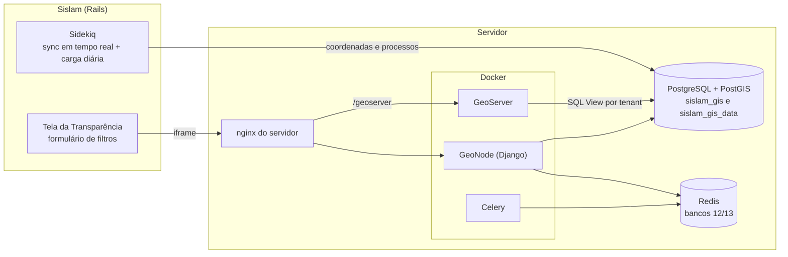

# Sislam GIS (GeoNode): avaliação do spike

Chamado: #34947 · Situação em 09/10/2026 · Detalhes técnicos de instalação e operação em
[IMPLEMENTACAO_SISLAM.md](IMPLEMENTACAO_SISLAM.md).

## 1. Resumo executivo

- **O que é:** uma plataforma de mapas (GeoNode + GeoServer, software livre) ligada ao Sislam. O Sislam
  continua dono dos dados e envia as coordenadas para uma base geográfica própria, separada por tenant;
  os mapas são servidos pelo GeoServer e embutidos nas telas do Sislam.
- **Primeiro caso de uso, já funcionando em ambiente local:** o mapa da Transparência, com os mesmos 8
  filtros da tela atual, aberto em iframe nos dois domínios (`*.sislam.com.br` e `*.msmeioambiente.com.br`).
- **Resultado medido (base `crs`):** o mapa novo mostra **exatamente os mesmos pontos válidos** que a
  consulta atual em 13 combinações de filtros, e carrega em **0,05–0,10 s** contra **4,8–5,8 s** do mapa atual.
- **Ganho colateral:** 267 das 2.021 coordenadas do `crs` (13%) são inválidas (preenchimentos como
  `-11.111111`, `0,0`, latitude e longitude invertidas). Hoje elas aparecem em lugares errados do mapa; no
  GeoNode ficam guardadas, mas fora do mapa.
- **Implantação gradual:** a troca é por tenant, por configuração. Quem não for habilitado continua no mapa
  atual, sem mudança.
- **Avaliação técnica:** viável para o mapa da Transparência. Antes de produção faltam o roteiro de
  homologação no servidor e alguns itens da seção 8; para mapas internos (com login) falta uma correção no
  token de SSO e o teste em Safari e Firefox.

## 2. Problema e objetivo

- O mapa da Transparência consulta a tabela polimórfica `coordenadas` com vários joins a cada acesso e monta
  todos os pontos em Ruby: é lento e cresce com o volume de dados.
- A intenção do produto é substituir os mapas atuais do Sislam por mapas em iframe e, no futuro, manter as
  coordenadas apenas na plataforma GIS.
- O chamado pedia: plataforma adotada, multi-tenant por grupo, SSO via JWT, mapas públicos/embutidos, ETL a
  partir de `Coordenada` com SRID único e uma estratégia de sincronização.

## 3. O que foi construído

| Parte | Onde | O que faz |
|---|---|---|
| Base geográfica | `sql/001`, `sql/002` (fork) | `sislam_coordenadas` (todas as coordenadas, SRID SIRGAS 2000) e `sislam_processos` (atributos dos filtros), com `tenant_id` em toda linha |
| Provisionamento | `sislam_provision_tenant` (fork) | Cria, por tenant, o grupo de acesso, a camada interna, a camada pública da Transparência e o mapa padrão |
| Mapa da Transparência | `/sislam/transparencia/<tenant>/` (fork) | Página OpenLayers que recebe os filtros pela URL, valida e aplica no GeoServer |
| SSO | `/sso/sislam-login/` (fork) | Login no GeoNode a partir de um JWT RS256 emitido pelo Sislam, colocando o usuário no grupo do tenant |
| Sincronização | Workers e rake (Sislam) | Tempo real ao salvar coordenada ou mudar status do processo; carga completa diária às 03:00 |
| Tela | `Transparencia::MapasController` (Sislam) | Mantém o formulário e troca o Google Maps pelo iframe nos tenants habilitados |

Testes automatizados no Sislam cobrem a sincronização, os atributos, a carga diária e a tela (51 exemplos,
entre novos e os que já existiam para a Transparência, todos passando).

## 4. Resultados medidos

Ambiente local, base `crs` (2.021 coordenadas, 871 visíveis no mapa da Transparência).

### Paridade com o mapa atual

| Caso | Mapa atual | GeoNode | Só no mapa atual (inválidas) | Só no GeoNode |
|---|---:|---:|---:|---:|
| Sem filtros (2000 até hoje) | 931 | 871 | 60 | 0 |
| Status Concluído | 184 | 167 | 17 | 0 |
| Status Tramitando / Em monitoramento | 369 | 352 | 17 | 0 |
| Tipo de solicitação (2 mais usados) | 170 / 128 | 155 / 114 | 15 / 14 | 0 |
| Tipo de documento (mais usado) | 154 | 123 | 31 | 0 |
| Bairro "centro" | 74 | 70 | 4 | 0 |
| Logradouro "rua" | 699 | 654 | 45 | 0 |
| Atividades (3 mais usadas) | 70 | 63 | 7 | 0 |
| Atividades de serviço (3 mais usadas) | 46 | 46 | 0 | 0 |
| Atividade ou atividade de serviço | 55 | 53 | 2 | 0 |
| Período 2024 | 119 | 119 | 0 | 0 |
| Status + bairro + período 2015–2025 | 9 | 9 | 0 | 0 |

Em todos os 13 casos: **nenhum ponto aparece só no GeoNode**, e todo ponto que aparece só no mapa atual é
uma coordenada inválida (fora do Brasil). Os scripts da comparação estão descritos em
[IMPLEMENTACAO_SISLAM.md](IMPLEMENTACAO_SISLAM.md#9-checklist-de-homologação).

### Desempenho (mesmo filtro, 931 pontos)

| Caminho | Tempo |
|---|---|
| Mapa atual: consulta + montagem dos pontos | 4,8 a 5,8 s |
| GeoNode: página | 0,10 s |
| GeoNode: imagem do mapa (WMS 1000×700) | 0,05 a 0,09 s |

O GeoServer desenha a imagem a partir de uma tabela indexada; o tempo não depende de montar ponto a ponto.

### Qualidade dos dados

267 coordenadas do `crs` (13%) não têm posição válida no Brasil: valores de preenchimento de cadastros de
2012–2015, latitude e longitude invertidas, UTM sem conversão. Ficam gravadas na base GIS, sem geometria. Vale
uma ação de saneamento no Sislam.

## 5. Decisões tomadas

| Decisão | Alternativa considerada | Motivo |
|---|---|---|
| GeoNode e GeoServer em Docker, usando nginx, PostgreSQL e Redis do servidor | Instalação nativa (Tomcat, uWSGI, systemd) | O GeoServer precisa do build específico do GeoNode; a imagem oficial já resolve versões e dependências. Atualizar vira trocar imagem |
| ETL: uma tabela de coordenadas e uma por model para atributos (`sislam_processos`) | GeoServer lendo direto o banco do Sislam | Ler o banco do Sislam repetiria a consulta lenta a cada imagem do mapa e exigiria acesso do GeoServer aos bancos de produção |
| Todas as coordenadas vão para a base GIS; visibilidade vira atributo | Mandar só as visíveis | O GIS vai ser a fonte das coordenadas no futuro, e mapas internos precisam ver tudo |
| Sincronização híbrida: tempo real para coordenada e status; lote diário para o resto | Só tempo real ou só lote | Status muda com frequência; endereço e atividades quase não mudam depois da criação. O lote também corrige eventos perdidos |
| Camada pública por tenant para a Transparência | Mapa com login | A Transparência é pública; sem login e sem cookie funciona em qualquer navegador |
| Página própria no GeoNode em iframe | Embed padrão do GeoNode (MapStore); mapa desenhado no Rails | O embed padrão não aceita os filtros do Sislam pela URL. A página própria mantém o modelo de iframe e fica reaproveitável |
| Troca por tenant (`GEONODE_TRANSPARENCIA_TENANTS`) | Trocar todos de uma vez | Implantação gradual, com volta imediata ao mapa atual |
| Cookies particionados (CHIPS) para mapas com login | Token na URL do iframe | Funciona nos dois domínios mesmo com cookies de terceiros bloqueados (testado no Chrome) |

## 6. Segurança e isolamento

- **Tenant:** toda linha da base GIS tem `tenant_id`; cada camada do GeoServer fixa o tenant no próprio SQL,
  e filtros enviados pela URL só podem restringir mais, nunca ampliar.
- **Camada pública:** só visualização (imagem do mapa e popup). Download dos dados (WFS) negado ao anônimo;
  camadas internas negadas ao anônimo. Verificado.
- **Filtros:** a página aceita apenas os 8 filtros conhecidos, valida tipos e limites e monta o filtro no
  servidor; tentativa de injeção é recusada (HTTP 400).
- **Iframe:** liberado apenas para os domínios do Sislam (`frame-ancestors`).
- **SSO:** JWT RS256 com validade de 60 s, emissor e audiência obrigatórios; a chave privada fica só no Sislam.
- **Rede:** GeoNode e GeoServer escutam só em `127.0.0.1`; o acesso externo passa pelo nginx do servidor.

## 7. Infraestrutura e custo

- **Licenças:** GeoNode, GeoServer, PostGIS e OpenLayers são software livre (sem custo de licença).
- **Servidor:** reutiliza nginx, PostgreSQL e Redis existentes. Consumo medido com o sistema parado:
  ~3,5 GB de RAM (django 0,7 GB, celery 1,2 GB, GeoServer 1,6 GB; o GeoServer está configurado para até 4 GB).
  Recomenda-se reservar **6 a 8 GB de RAM** e **20 GB de disco** (imagens ~5,4 GB, mais logs e arquivos).
- **Mapa de fundo:** hoje usa os tiles públicos do OpenStreetMap. Com tráfego alto em produção, a política de
  uso do OSM pede um provedor próprio ou contratado.
- **Manutenção:** as customizações ficam em apps separados do projeto (`sislam_sso`, `sislam_tenant`),
  sem alterar o núcleo do GeoNode, o que facilita atualizar versões. Exige familiaridade com Docker, Django e
  GeoServer na equipe.

## 8. Riscos e pendências

| Item | Impacto | Ação proposta |
|---|---|---|
| Token de SSO do Sislam sem `iss`/`aud` | Mapas internos (com login) não funcionam ainda | Incluir as duas claims em `SislamSign::GeonodeToken` |
| CHIPS testado só no Chrome | Mapas internos podem falhar em Safari/Firefox | Testar; plano B: token na URL do iframe |
| Sync em tempo real roda em todos os tenants | Servidor do Sidekiq sem acesso à base GIS gera jobs com erro | Configurar `GEONODE_GEODATABASE_*` em todos os servidores do Sidekiq antes do deploy |
| Redis e PostgreSQL sobem antes do Docker no boot | Após reboot, os containers perdem acesso ao Redis/Postgres | `After=docker.service` nos dois serviços (roteiro de instalação) |
| Coordenadas inválidas (13% no `crs`) | Pontos fora do mapa | Saneamento no Sislam |
| Só pontos; linhas/polígonos (KML) e o campo `preenchido` (GMS/UTM) não são usados | Geometrias complexas fora do GIS | Evolução futura |
| Atributos só de Processo | Outros mapas/relatórios precisarão de novas tabelas | Levantar atributos por model conforme cada mapa |
| Chave privada do SSO versionada no repositório do Sislam | Exposição da chave para quem tem acesso ao repositório | Decidir guarda (variável de ambiente/cofre) |
| `%` e `_` digitados no filtro de bairro/logradouro funcionam como curinga | Diferença pequena em relação ao mapa atual | Aceitar ou tratar depois |
| Container `memcached` sobe sem uso | Consumo desnecessário (~7 MB) | Remover do compose |

## 9. Próximos passos

1. Homologar no servidor seguindo [IMPLEMENTACAO_SISLAM.md](IMPLEMENTACAO_SISLAM.md) (seções 5 e 9).
2. Habilitar a Transparência para um tenant piloto (`GEONODE_TRANSPARENCIA_TENANTS`) e acompanhar.
3. Corrigir o token de SSO e testar mapas internos em Safari e Firefox.
4. Expandir tenant a tenant; remover o mapa antigo quando todos migrarem.
5. Planejar os próximos mapas (atributos por model, geometrias além de ponto) e o saneamento das coordenadas.
